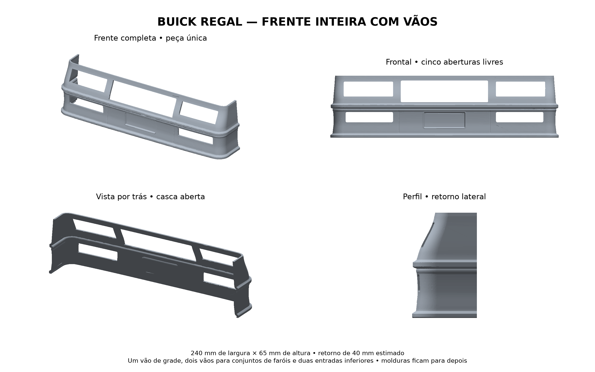
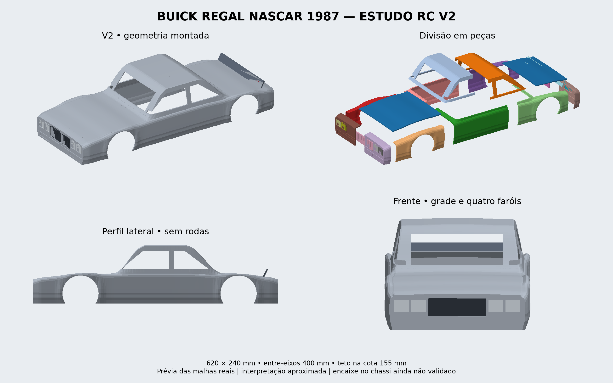

# MICROTEC — Buick Regal RC

Estudo de carroceria do Buick Regal NASCAR 1987 para controle remoto, a partir do esboço fornecido. Comprimento 620 mm, largura 240 mm, entre-eixos 400 mm.

## Foco atual: frente inteira em peça única

[Ver imagens da frente](frente_inteira/previa_frente_inteira.png) · [Baixar STL e imagens](Frente_Inteira_Buick_STL.zip) · [Medidas e instruções](frente_inteira/LEIA-ME.md)

Uma única casca com cinco vãos atravessantes: grade, dois conjuntos de faróis e duas entradas inferiores. Sem molduras ou insertos; a área central da placa permanece fechada. Dimensões: largura 240 mm, altura 65 mm e retorno lateral estimado de 40 mm. Não validada em impressão física ou no chassi.

O [estudo anterior da faixa inferior](parachoque_dianteiro_estudo/LEIA-ME.md) está preservado como histórico.

## Carroceria anterior: V2

[Baixar pacote V2](Buick_Regal_RC_V2.zip) · [Ver os STL](modelo_v2/stl) · [Instruções e limitações](modelo_v2/LEIA-ME.md)

23 arquivos STL: 22 peças de montagem e uma tala auxiliar. Malhas e interferências volumétricas verificadas; impressão física, tolerâncias e encaixe no chassi ainda não validados. Modelo aproximado, em refinamento.

A [V1](modelo_v1/LEIA-ME.md) está preservada para comparação.
