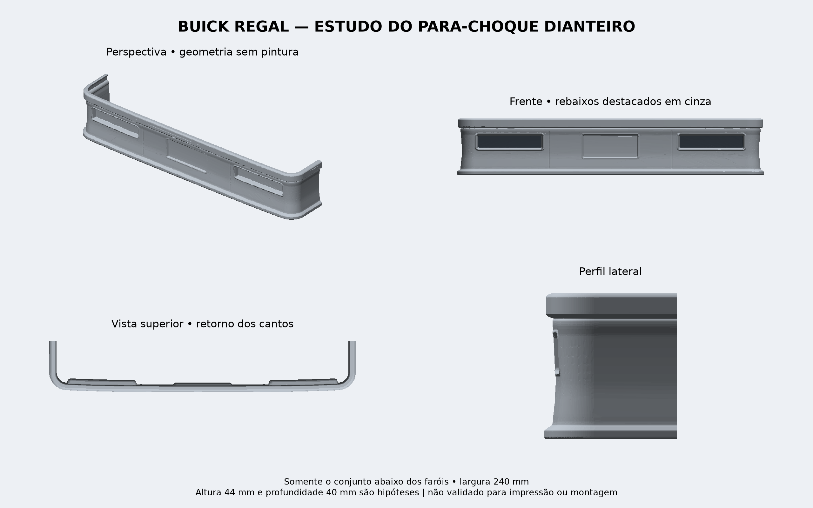

# MICROTEC — Buick Regal RC

Estudo de carroceria do Buick Regal NASCAR 1987 para controle remoto, a partir do esboço fornecido. Comprimento 620 mm, largura 240 mm, entre-eixos 400 mm.

## Foco atual: somente o para-choque dianteiro

[Ver estudo ampliado](parachoque_dianteiro_estudo/previa_parachoque.png) · [Baixar STL e imagens](Parachoque_Dianteiro_Estudo.zip) · [Hipóteses, medidas e instruções](parachoque_dianteiro_estudo/LEIA-ME.md)

Estudo da região abaixo dos faróis, com frisos, rebaixos e retornos laterais. Largura 240 mm; altura 44 mm e profundidade 40 mm ainda estimadas. Entrega a peça inteira e, como alternativa, duas metades. Não integrado automaticamente à carroceria V2. O restante do carro aguarda revisão da forma desta peça.

## Carroceria anterior: V2

[Baixar pacote V2](Buick_Regal_RC_V2.zip) · [Ver os STL](modelo_v2/stl) · [Instruções e limitações](modelo_v2/LEIA-ME.md)

23 arquivos STL: 22 peças de montagem e uma tala auxiliar. Malhas e interferências volumétricas verificadas; impressão física, tolerâncias e encaixe no chassi ainda não validados. Modelo aproximado, em refinamento.

A [V1](modelo_v1/LEIA-ME.md) está preservada para comparação.
