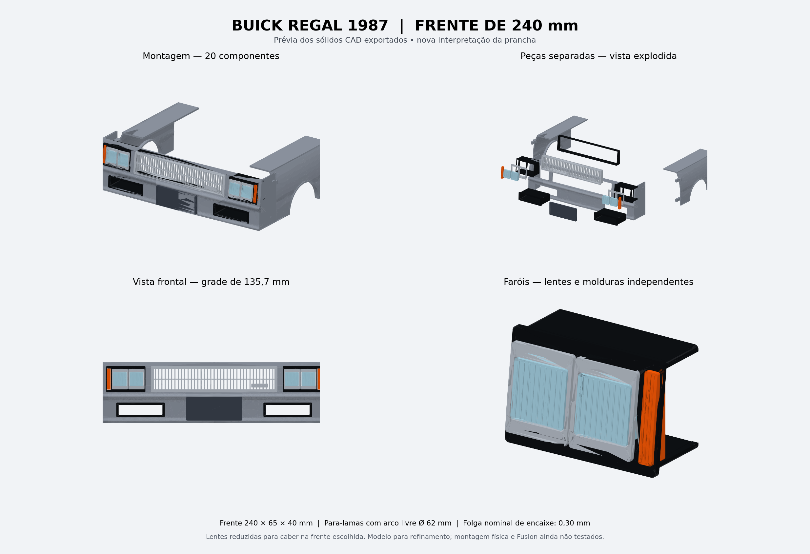

# Buick Regal 1987 — frente de 240 mm

Novo estudo CAD a partir da prancha de peças separadas. **20 componentes em
STEP, uma montagem e um script que gera 21 arquivos F3D dentro do Autodesk
Fusion instalado no seu computador.** Não há arquivos F3D prontos neste ZIP:
o Fusion não está instalado no ambiente usado para preparar os sólidos.

[Baixar o pacote completo](https://github.com/evildinomar2-dot/MICROTEC/raw/refs/heads/main/Buick_Regal_240_CAD_Fusion.zip)
· [Ver a prévia](PREVIA_BUICK.png)
· [Como gerar os F3D](fusion/COMO_GERAR_F3D.md)



## Abrir no Fusion

1. Extraia o ZIP inteiro.
2. No Fusion, abra **Utilitários → Scripts e complementos → Scripts**.
3. Adicione a pasta **fusion/CriarBuickF3D** e execute **CriarBuickF3D**.
4. Os arquivos nativos `.f3d` serão gravados na pasta **F3D_GERADOS**, dentro
   do pacote extraído. O script mantém a montagem aberta e informa o resultado.

Também é possível abrir `BUICK_FRENTE_MONTAGEM.step` diretamente no Fusion e
usar **Arquivo → Exportar → Fusion Archive (.f3d)**. Nenhuma instalação de
Python ou CadQuery é necessária para abrir os STEP ou executar o script no Fusion.

Os arquivos contêm **sólidos CAD BRep editáveis**, com curvas e superfícies,
e não malhas STL convertidas. O STEP não contém os esboços nem o histórico das
operações originais. A conversão para F3D permite trabalhar no formato do
Fusion, mas **não recria esse histórico**. O script ativa, quando possível,
o registro das novas operações feitas após a importação.

## Peças e dimensões

Medidas em milímetros. Para os componentes da frente, as colunas indicam
largura em Y, altura em Z e profundidade em X. O encaixe dos para-lamas
acrescenta 10 mm à frente do painel de 120 mm.

| Componente | Quantidade | Largura × altura × profundidade |
|---|---:|---|
| Para-choque / frente inteira | 1 | 240 × 65 × 40 |
| Grade central com barras | 1 | 135,7 × 28 × 10 |
| Carcaça do conjunto de dois faróis | 2 | 42 × 28 × 20 |
| Lente do farol | 4 | 14,6 × 14,6 × 6 |
| Lente do pisca | 2 | 3,6 × 22,4 × 6 |
| Moldura individual do farol | 4 | 17,2 × 21,8 × 5 |
| Duto inferior aberto | 2 | 52 × 15,5 × 30 |
| Anel de suporte traseiro da grade | 1 | 135,7 × 28 × 10 |
| Placa opcional | 1 | 60 × 25 × 3 |
| Para-lama dianteiro | 2 | painel: 120 de comprimento × 40 de largura × 65 de altura |

Os para-lamas têm arco de roda livre de **62 mm de diâmetro** e duas abas
integradas por lado. Incluindo as abas, cada sólido mede **130 × 40 × 65 mm**
em X/Y/Z. Esquerda e direita são identificadas olhando para a frente a partir
do interior do carro. X cresce para trás, Y indica a largura, Z aponta para cima.

## Interpretação da prancha e encaixes

A prancha mistura cotas incompatíveis: o conjunto indicado com 27,5 mm não
comporta dois faróis de 24 mm e um pisca de 8 mm. Conforme a escolha do usuário,
foram preservados **240 mm na frente e 135,7 mm na grade**, e as lentes e
molduras foram reduzidas para caber. Esta é uma interpretação modelável da
referência, não uma reprodução dimensional certificada do Buick original.

- A frente possui cinco aberturas reais: grade, dois conjuntos de faróis e
  dois dutos inferiores. A região da placa é fechada.
- Mangas e aberturas têm **0,30 mm de folga nominal por lado**. As abas
  externas têm afastamento frontal de 0,25 mm da carroceria.
- A base da carroceria usa parede nominal de 2 mm; frisos e superfícies curvas
  alteram a espessura medida na direção normal. Os aros mais finos, inclusive
  o suporte da grade, exigem conferir os perímetros no fatiador.
- As duas abas de cada para-lama deslizam nas luvas internas da frente. A
  folga longitudinal entre os painéis é de 0,30 mm.
- Grade, molduras, lentes e anel traseiro foram preparados para montagem por
  colagem. Não foram criados encaixes elásticos, roscas ou fixações ao chassi.
- A placa opcional é plana e precisa de espaçadores/adesivo adequados ao perfil
  curvo da frente. Pode ser ocultada ou removida da montagem.
- As lentes têm estrias decorativas; não incluem cálculo óptico, refletores,
  LED, fiação ou suportes elétricos. A transparência depende do material e do
  acabamento da impressão. A base do emblema na grade não contém letras.

## Conferências realizadas

`validacao_cad.json` registra o resultado dos testes dos arquivos entregues:

- 20 arquivos individuais, cada um com um sólido válido após exportar e reabrir;
- montagem STEP reimportada com 20 sólidos válidos;
- passagem livre pelas cinco aberturas da casca frontal;
- interseção volumétrica entre os pares cujas caixas delimitadoras se sobrepõem.

A prévia é renderizada dos próprios STEP. **A importação no Fusion e a montagem
física ainda não foram testadas.** A ausência de interseção geométrica não
substitui um teste de impressão: imprima primeiro uma pequena região de encaixe
para conferir as folgas na sua impressora. A frente inteira requer espaço para
uma peça de 240 mm ou divisão posterior no Fusion.

## Arquivos e regeneração

- `step/`: 20 peças separadas, posicionadas nas coordenadas da montagem;
- `BUICK_FRENTE_MONTAGEM.step`: conjunto com nomes e cores;
- `fusion/`: script e instruções para gerar os F3D;
- `cad/`: código-fonte do modelo e da verificação;
- `PREVIA_BUICK.png` e `VISTA_FRONTAL.png`: prévias;
- `MEDIDAS.csv`: dimensões medidas dos sólidos exportados;
- `validacao_cad.json`: relatório de validação.

Para alterar as fontes e regenerar fora do Fusion, use Python 3.12 e as versões
em `requirements.txt`:

```sh
python -m pip install -r requirements.txt
python cad/body.py
python cad/details.py
python cad/assemble.py
python cad/preview.py
```

As medidas-base e as interfaces estão em `cad/common.py`; a carroceria e os
acessórios estão em `cad/body.py` e `cad/details.py`. Algumas dimensões dos
acessórios são explícitas nesses arquivos e precisam ser ajustadas em conjunto.
No Fusion, ao reduzir o conjunto, selecione todos os componentes e aplique o
mesmo fator de escala; isso também reduz paredes e folgas.
